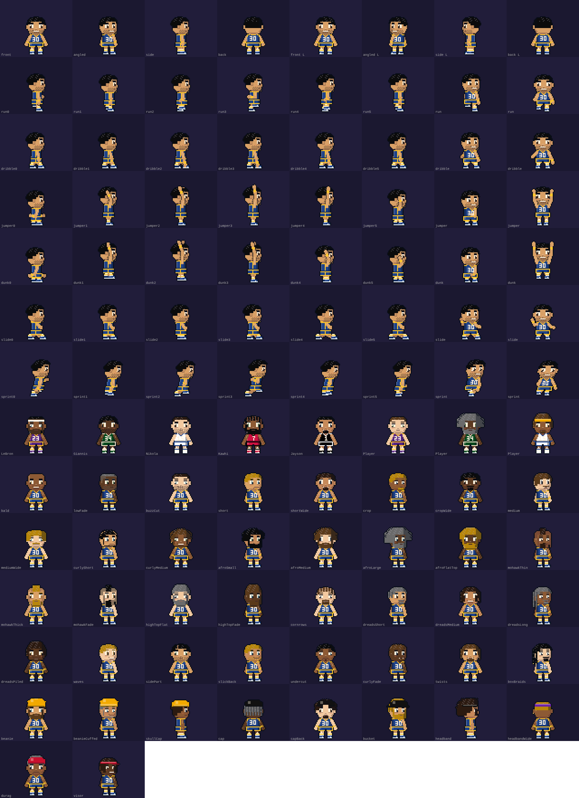

# Court Vision — Player Visual Upgrade (v2 characters)

New 44 px tall characters for the live court, in a slightly cartoonish style: a bigger head on a compact body.

## What's new

- **Four directions.** Each player is drawn from the front, at an angle (three-quarter), in profile, and from the back.
  - Running down the screen shows the front. Running up the screen shows the back. Running along the court shows the profile.
  - Diagonal movement, standing, and defensive stances use the angled view.
  - Shots, passes, dives, charges and steals always use the profile view, so you can read the action toward the rim.
  - A few degrees of hysteresis stop a player from flickering between two views near a boundary.
- **The same players.** Skin, all 32 hairstyles, 25 beard styles, 10 kinds of headwear, eye colour and style, expression, goggles, shooting sleeve, wristbands, graying with age, and team kits all come from the existing `playerTraits()`. Real-player likenesses and looks saved in Edit Player carry over. **There is no save migration.**
- **Every animation.** The full classic animation sheet (37 actions × 6 frames) is projected into each view, including run, dribble, shoot, dunk and defence. Facing left mirrors the body, but jersey numbers always read the right way round.
- **A setting.** Watch Game → Camera & display → **Players** switches between *v2 characters* (the default) and *Classic sprites*. The choice is saved in this browser.

## Where it lives

- `src/visuals/chibiSprite.ts` contains:
  - the v2 head and body for each view;
  - pose projection;
  - the rasterizer and its cache;
  - `courtView()`, which picks the view.
- `src/components/WatchCourt.tsx`: the `sprites` prop (`'v2' | 'classic'`) and view selection for each player.
- `src/components/WatchGame.tsx`: the Players setting.
- `src/tests/chibiSprite.test.ts` covers:
  - size;
  - the four views and jersey-number visibility;
  - left-facing numbers;
  - every animation frame in every view;
  - reach and lying poses;
  - every hair, beard and hat style;
  - view selection and hysteresis.

## Not in this update

- Portraits, roster cards, the bench and the profile character still use the classic 40 × 52 art.
- Animations are re-projected from the classic poses, not newly hand-drawn frames, and they keep the existing frame timing.
